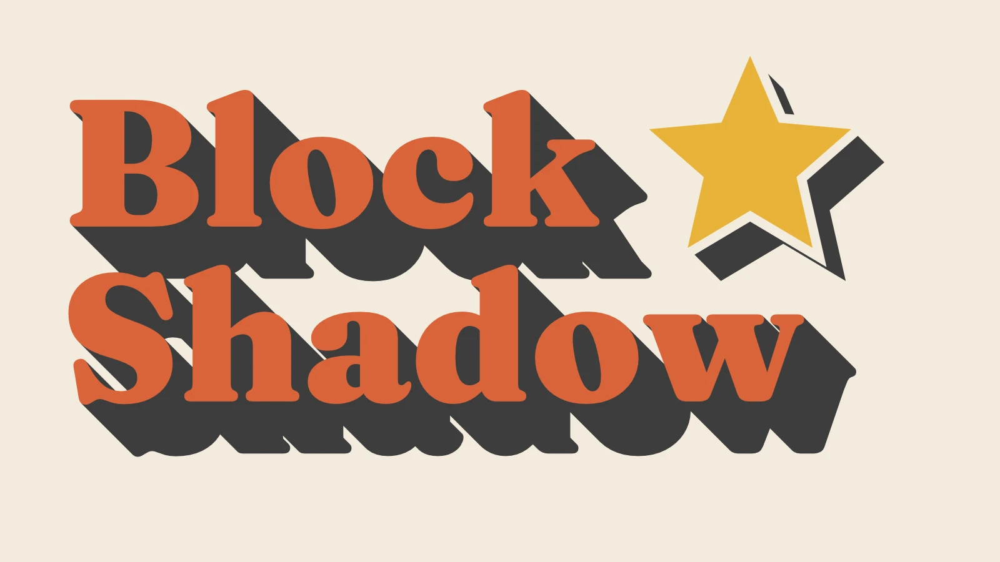
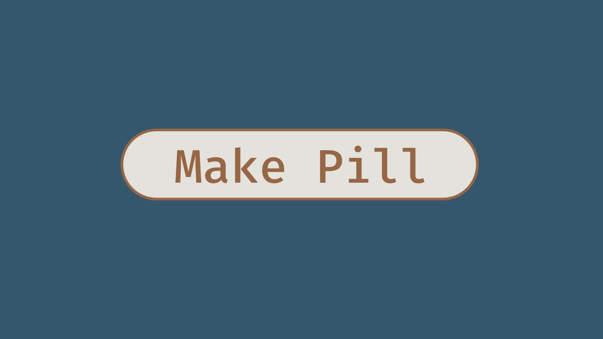
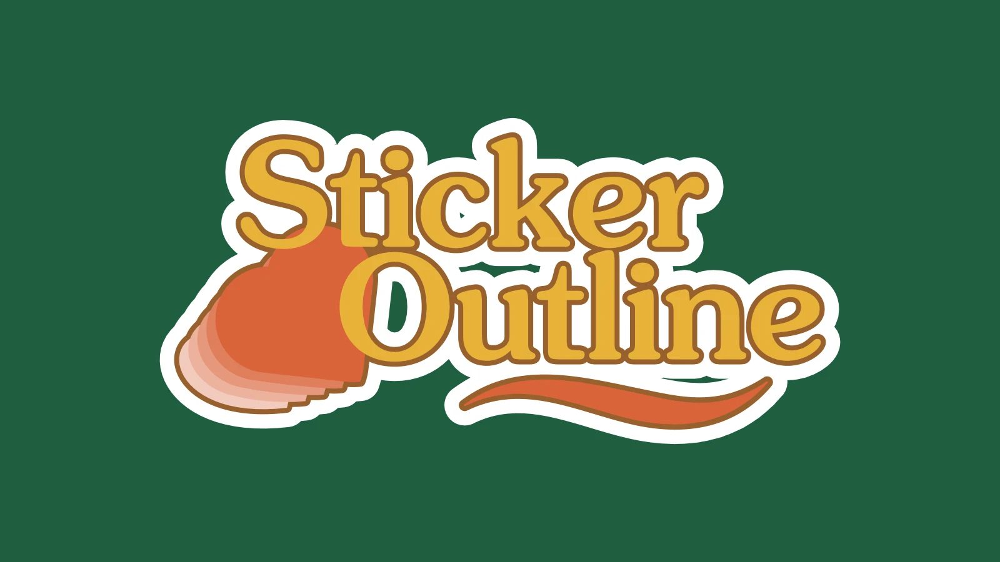

# Affinity Scripts

Scripts for [Affinity](https://www.affinity.studio/) 3.3 or later that add tools Affinity doesn't
have built in. Each one opens a small dialog with a live preview, makes clean vector shapes
(never pixels), and finishes in one undo step.

Affinity's scripting is in beta, so a future Affinity update may need a script updated too.

## Scripts

| Script | What it does | Version |
|---|---|---|
| [Block Shadow](#block-shadow) | A solid, flat block shadow (a "long shadow") for each selected object | 1.6.1 |
| [Make Pill](#make-pill) | A rounded pill with set padding around its text, or refits selected pills | 1.0 |
| [Rosette Halftone](#rosette-halftone) | Turns an object into a black halftone of true vector dots | 1.0 |
| [Sticker Outline](#sticker-outline) | One solid, round-cornered sticker or die-cut shape around your artwork | 1.2.1 |

Block Shadow, Make Pill and Sticker Outline are in this repo. Rosette Halftone lives in its own [repo](https://github.com/datatimp/rosette-halftone/tree/main/affinity), next to
the command-line tool whose dot math it shares.

## Install

Each script comes two ways, and either one works:

- **`afscript/`** holds each script exported from Affinity, ready to import.
- **`src/`** holds the same script as plain JavaScript, to paste into Affinity's Script Editor.

None of these scripts reads your files, uses the network or uses Canva AI, so they need none of
those permissions.

The steps below follow Affinity's own help pages, [Running scripts](https://www.affinity.studio/help/running-scripts/)
and [Trusting scripts](https://www.affinity.studio/help/trusting-scripts/). Affinity's scripting is
in beta, so if a menu or button below doesn't match your copy of Affinity, those pages have the
current steps.

### Turn on scripting (once)

Scripting is off in Affinity until you turn it on.

1. Select **Affinity ▸ Settings** (Mac) or **Edit ▸ Settings** (Windows).
2. Select **Scripting**, then select **Enable Affinity Scripting**.

The scripting panels are on the **Window** menu under **Scripting**: you'll use the **Scripts
Library** panel and, for the paste method, the **Script Editor** panel.

### Method 1: import the .afscript file

1. Download the script's `.afscript` file from [`afscript/`](afscript/).
2. On the **Scripts Library** panel, open the options menu of the category you want it in (the icon
   next to the category name), then select **Import Script**.
3. Select the `.afscript` file, then select **Open**.

Affinity marks every imported script as untrusted, shown by an alert icon beside it. The first time
you run it, Affinity asks what to do: select **Trust & Run**. Or trust it ahead of time: right-click
it (⌃-click on Mac) on the Scripts Library panel and select **Mark as Trusted**. If you'd like to read
the code first, select **Show in Editor** in that same dialog.

### Method 2: paste the JavaScript

1. Open the script's `.js` file in [`src/`](src/) and copy all of it.
2. On the **Script Editor** panel, select **New Script**, then paste into the code area.
3. Select **Save As**, give the script a name and a description, choose a category, then select
   **Save**.

The script appears on the Scripts Library panel. A script you paste and save yourself is trusted
straight away.

### Run a script

Select the object or artwork, then click the script on the **Scripts Library** panel.

## Block Shadow



Adds a solid shadow that runs from each object's edge in one direction, like a 3D extrusion seen
flat on.

1. Select one or more objects: shapes, curves, text or groups. A group gets one shadow for
   everything in it.
2. Run **Block Shadow**. The dialog previews the shadow live on the canvas:
   - **Depth:** how far the shadow reaches.
   - **Direction (°):** which way it falls. 0° is right, 90° is up, -45° is down and to the right.
   - **Gap:** an empty band between the object and its shadow, 0 by default. It can't be more
     than the depth. See below.
   - **Colour:** the shadow's colour.
3. Click **OK**. Each object is grouped with its shadow, a curve named "Block shadow" at the
   bottom of the group.

**Changing a shadow:** run Block Shadow again on the group, on the object inside it or on the old
shadow. The old shadow is replaced inside the same group, so groups don't pile up inside each
other. Hidden objects in the group don't count: they cast no shadow.

**The gap** is the same width on every edge, whatever the direction, and its corners follow the
object's own: a sharp corner keeps a sharp (mitered) corner, a rounded one stays rounded. A very
sharp point, like a thin star tip, would push its corner far out, so past four times the gap it's
cut off flat instead, like Affinity's miter limit on strokes. The gap is empty, not white, so
whatever is behind shows through it.

**How it works:** the shadow is the exact area the object's outline sweeps as it slides in the
shadow's direction, built from the outline's own curves and joined with Add. It's one clean
shape, not a stack of copies, so the edges never step. For a gap, the object is grown outward by
the gap, with mitered corners, and that grown shape is cut out of the shadow with Subtract.

**Limits:**

- Strokes don't cast a shadow, only fills. To shadow a thick stroke, use Layer ▸ Expand Stroke
  first.
- The shadow doesn't update when the object changes. Run the script again to replace it.

## Make Pill



Makes a pill, a rounded shape with a line of text on it, with exact padding between the text and
the edge, like padding in web and UI design. Affinity doesn't keep a shape fitted to its text, so
the same script also refits pills after you change their words, font or size.

**To make a pill:**

1. Select nothing, or select a piece of text whose font and size the pill should copy.
2. Run **Make Pill**. The dialog previews the pill live on the canvas:
   - **Text:** the pill's words. If you selected text, it starts with that text's words.
   - **Left**, **Right**, **Top** and **Bottom:** the padding on each side, in pixels.
3. Click **OK**. A group named "Pill" appears: a fully rounded rectangle with a 2 px black stroke
   and no fill, and the text, centred, on top. With text selected, it goes just below that text;
   otherwise it goes in the middle of the spread, in Affinity's default text style.

The rectangle is an ordinary shape, so you can change its corners, fill and stroke afterwards.

**To refit pills:** select one or more pills and run **Make Pill**. The dialog is the same without
the Text box. Click **OK** and each pill's shape resizes around its text; the text doesn't move. A
pill is a group of one shape and one piece of text, artistic or frame. A shape and a text selected
on their own, ungrouped, count as one pill too. Anything else in the selection is left alone, and
a message names what was skipped.

**How a pill is fitted:**

- **Width:** the letters themselves plus the left and right padding, so every pill gets the same
  visible gap whatever its words.
- **Height:** the font's cap height plus the top and bottom padding. The font is measured, not
  the word, so every pill with the same font and size comes out the same height.
- **Up and down:** the shape is centred on the letters, descenders included, just as Affinity's
  Align Vertical Centre centres text. A word in capitals gets the top and bottom padding exactly;
  a word with descenders, like "Vegan", rises a little so it's centred as a whole.

The padding runs to the shape's path, and a stroke sits half inside it.

**How it works:** Affinity's scripting doesn't report a font's cap height, so the script measures
it. It adds a few hidden test texts in the pill's font and size, reads
their outlines, and undoes the step. Refitting scales the shape, and Affinity redraws a shape from
its settings, so round ends stay round.

**Limits:**

- One line of text per pill.
- Rotated or skewed pills are skipped.
- Text typed into a shape itself is skipped, because Affinity places that text, not the script.
  Select it and run **Make Pill** to make a new pill in the same font instead.

## Rosette Halftone

Turns the selected object into a black halftone made of true vector circles, using the dot math of
[Rosette](https://github.com/datatimp/rosette-halftone), a halftone tool for the command line. Every
dot is an exact circle, so Affinity's vector tools keep working on the result, and a shape's edge
never gets the border of heavy dots that Affinity's Live Halftone gives it.

The dialog sets the cell size, screen angle, gamma and minimum dot size, with a live preview, and
makes the dots as one compound shape or as separate dots in a group.

Its `.afscript` file, JavaScript and full instructions are in the
[`affinity`](https://github.com/datatimp/rosette-halftone/tree/main/affinity) folder of the
rosette-halftone repo. It installs the same two ways as the scripts here.

## Sticker Outline



Draws the shape you'd cut a sticker along: everything within a set distance of your artwork, with
round corners, as one solid piece.

1. Select the artwork: any number of objects or groups.
2. Run **Sticker Outline**. The dialog previews the outline live on the canvas:
   - **Offset:** how far the outline sits outside the artwork.
   - **Fill holes:** off by default. Fills the counters of letters, the gaps between parts and any
     other holes, so the sticker is solid.
   - **Colour:** the outline's colour, white by default.
3. Click **OK**. The artwork and the outline are grouped together, with the outline, a curve named
   "Sticker outline", at the bottom of the group.

**Only the selection is outlined.** Anything you haven't selected is left alone, including an older
sticker outline. To layer outlines, select an outline along with the artwork (or the group holding
both) and run the script again with a larger offset: the new outline goes around both.

**What counts as artwork:** every filled shape, curve and piece of text, and every visible stroke
at its full width, whatever its alignment. A stroke with a pressure profile, tapered in the
Stroke panel or drawn with a pen, counts at the width the pressure gives it along its length. An
open line with only a stroke, like a spiral, gets an
outline around the stroke. Images and adjustments are skipped.

**How it works:** the outline is everything within the offset of the artwork, built from short
bands along every curve plus circles at the corners and ends, all joined with Add.

**Limits:**

- Parts of the artwork that are further apart than twice the offset stay separate pieces. Raise
  the offset to join them.
- The outline doesn't update when the artwork changes. Delete it and run the script again.
- The in-between steps of a blend aren't real objects, so the script doesn't see them. Convert
  the blend group to curves first (**Vector > Convert to Curves**, or Ctrl+Enter), then run the
  script.
- The outline has far more nodes than an offset path drawn by hand. Affinity's scripting has no
  offset path or Expand Stroke command, so the script builds the outline from many small pieces,
  and each joined edge leaves nodes behind.

## Grouping

Block Shadow and Sticker Outline group their result with the objects you selected. If the selected objects weren't
next to each other in the Layers panel, grouping brings them together, and anything unselected
that sat between them ends up outside the group. That's how Affinity's own Group works.

## Repo layout

This layout covers Block Shadow, Make Pill and Sticker Outline; Rosette Halftone's files are in
its own repo.

```
affinity-scripts/
├── afscript/   scripts exported from Affinity, ready to import
├── src/        the same scripts as JavaScript source
├── LICENSE
├── README.md
└── ROADMAP.md  planned changes and what they're waiting on
```

The JavaScript in `src/` is the source: a change is made there first, then pasted into Affinity
and exported again to `afscript/`. Each script's version is in the comment at the top of its file.

## License

[GNU Affero General Public License v3.0 or later](LICENSE). Copyright (C) 2026 datatimp.
